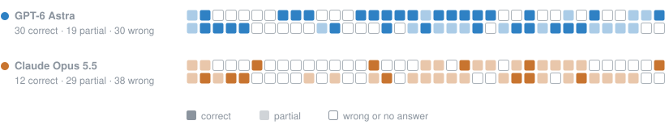
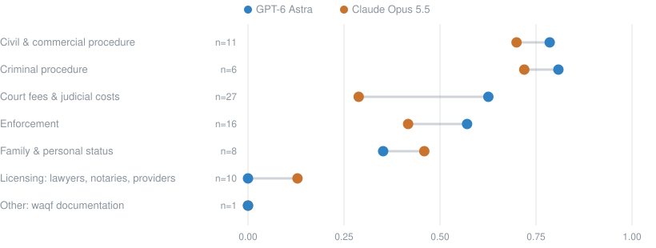

# Najiz Closed-Book: can frontier models recall basic Saudi law?

**The best model fully answered 30 of 79 basic questions on Saudi law.**

We asked GPT-6 Astra and Claude Opus 5.5 79 short, practical questions about Saudi legal procedure, fees and licensing, from memory and without search. These are the kind of questions a court portal's help page answers. Neither model could reliably retrieve them.

**Mohamed Zaghoo** · November 2026 · Questions from the public [ArabLegalEval](https://github.com/Thiqah/ArabLegalEval) Najiz set · Graded blind by Claude Sonnet 5.5

[Results](#results) · [Findings](#what-we-found) · [Examples](#three-examples) · [Run the demo](#run-the-demo) · [Method](#how-we-tested) · [Limitations](#limitations) · [Full report (PDF)](docs/report.pdf)

| | GPT-6 Astra | Claude Opus 5.5 |
|---|---:|---:|
| Fully correct | **30 / 79** | 12 / 79 |
| Partial | 19 | 29 |
| Wrong or no answer | 30 | 38 |
| Mean rubric score (0–1) | **0.536** | 0.398 |
| Answered «لا أعرف» ("I don't know") | 26 | 6 |
| Wrong among questions attempted | 4 of 53 | 32 of 73 |

## Results



*One square per question, in the benchmark's order (Q1 to Q79). Correct means a rubric score of at least 0.85 with every core principle, deadline and amount present.*



*Mean rubric score by area of law. Areas were assigned by the author from each question's subject; they are not part of the benchmark.*

| Area of law | Questions | Astra mean | Opus mean | Astra correct | Opus correct |
|---|---:|---:|---:|---:|---:|
| Criminal procedure | 6 | 0.81 | 0.72 | 3 | 1 |
| Civil & commercial procedure | 11 | 0.79 | 0.70 | 8 | 5 |
| Court fees & judicial costs | 27 | 0.63 | 0.29 | 10 | 3 |
| Enforcement | 16 | 0.57 | 0.42 | 7 | 2 |
| Family & personal status | 8 | 0.35 | 0.46 | 2 | 1 |
| Licensing: lawyers, notaries, providers | 10 | 0.00 | 0.13 | 0 | 0 |
| Other: waqf documentation | 1 | 0.00 | 0.00 | 0 | 0 |

## What we found

1. **Simple facts are the weak point.** These questions ask for a fee, a deadline or a list of conditions that a Saudi lawyer would look up in seconds. The stronger model was fully correct on 38% of them, and the other on 15%.
2. **Implementing regulations are a blind spot for both.** Neither model fully answered any of the 10 licensing questions (lawyers, notaries, foreign law firms, enforcement providers). Court fees split the models: Astra recalled exactly half of the 16 fee and rate amounts, while Opus got 2 right and mostly guessed wrong.
3. **The models fail in different ways.** Astra said «لا أعرف» on 26 questions and was wrong on only 4 of the 53 it attempted. Opus attempted 73 and was graded wrong on 32 of them, including 9 wrong amounts or deadlines stated as fact.
4. **A correct principle is not a correct answer.** Many answers named the right rule but left out the deadline, the exception or the conditions the reference requires. Under the rubric those count as partial, not correct.

### What the low scores suggest

These are not reasoning tasks. Each question has a short, settled answer in a Saudi statute, regulation or ministry rule. When frontier models miss them, the likeliest explanation is that this material is thin in their training data: Saudi implementing regulations, fee schedules and licensing rules are published mostly in Arabic, change often, and are rarely discussed online in the way that, for example, US federal procedure is.

The pattern supports that reading. Both models did best on rules set out in the main statutes, which are widely reproduced, and worst on regulations and ministry procedures. This study cannot separate missing training data from other causes, such as rules changing after a model's training or the effect of asking in Arabic.

> **For anyone deploying legal AI in Saudi Arabia:** closed-book answers to basic procedural questions are not yet reliable. A model needs current, cited sources, and a confident answer without one should be checked.

## Three examples

**Q14 · What are the court costs for a financial enforcement request?**

| | Answer | Grade |
|---|---|---|
| Reference | <div dir="rtl">2% من قيمة المطالبة، على ألا تقل عن خمسمائة ريال ولا تزيد على عشرة آلاف ريال.</div> | |
| GPT-6 Astra | <div dir="rtl">اثنين في المائة من قيمة المطالبة، بحد أدنى خمسمائة ريال وحد أقصى عشرة آلاف ريال.</div> | Correct |
| Claude Opus 5.5 | <div dir="rtl">لا أعرف المقدار بدقة؛ تخمين: نسبة من قيمة المطالبة يتحملها المنفذ ضده.</div> | Wrong |

Astra recalled the exact rate, minimum and maximum. Opus knew only that a percentage applies.

**Q10 · What are the court costs for cases heard in the labour courts?**

| | Answer | Grade |
|---|---|---|
| Reference | <div dir="rtl">ألفا ريال.</div> | |
| GPT-6 Astra | <div dir="rtl">للدعوى العمالية غير محددة القيمة تكاليف قدرها ألفا ريال، مع مراعاة الإعفاء المقرر للعمال…</div> | Correct |
| Claude Opus 5.5 | <div dir="rtl">الدعاوى العمالية المرفوعة من العامل معفاة من التكاليف القضائية.</div> | Wrong |

Opus stated the worker exemption as the whole answer and missed the 2,000-riyal fee that applies otherwise.

**Q47 · What are the conditions for a lawyer's licence?**

| | Answer | Grade |
|---|---|---|
| Reference | <div dir="rtl">… أن تتوافر لديه خبرة في طبيعة العمل لمدة لا تقل عن سنتين …</div> | |
| GPT-6 Astra | <div dir="rtl">لا أعرف</div> | Wrong |
| Claude Opus 5.5 | <div dir="rtl">… خبرة عملية (ثلاث سنوات أو أقل لحملة الدراسات العليا) …</div> | Wrong |

Opus listed most conditions correctly but gave the experience requirement as three years instead of two. A wrong period cuts the score by 70%.

## Run the demo

Python 3.9+. No dependencies, no API key.

```bash
git clone https://github.com/mzaghoo/najiz-closed-book-eval.git
cd najiz-closed-book-eval
```

**1. Verify every published number (offline).** Checks the answer-file fingerprints, recomputes all 158 scores from the grader's element-by-element decisions, unblinds A/B and prints the tables above.

```bash
python3 -m najiz_eval.verify
```

**2. Look at any question.** Shows both answers, the rubric elements and how each answer was graded.

```bash
python3 -m najiz_eval.explore 14
```

```bash
python3 -m najiz_eval.explore --list wrong --model claude-opus-5.5
```

**3. Add the question and reference text.** The benchmark text is not redistributed here (see [Data and licence](#data-and-licence)). This downloads the exact source file from ArabLegalEval, checks its SHA-256, and rebuilds the full rubric, which must match the fingerprint used at grading time.

```bash
python3 -m najiz_eval.fetch
```

**4. Grade your own model.** Answer the questions closed-book, build a blind package, give it to a grader model, then score the grader's output.

```bash
python3 -m najiz_eval.package questions out/questions.json
```

```bash
python3 -m najiz_eval.package build my_answers.json answers/gpt-6-astra.json -o out/
```

```bash
python3 -m najiz_eval.package score out/grades.json --key out/key.json
```

**Tests**

```bash
python3 -m unittest discover tests
```

## How we tested

**Questions.** All 79 questions in the public [Najiz QA set](https://github.com/Thiqah/ArabLegalEval/blob/main/benchmarkQA/Najiz_QA_with_context_v2.benchmark.json) from ArabLegalEval, with its reference answers. The benchmark supplies context passages; we did not, so this run measures recall from memory only.

**Answering.** Each model answered all 79 questions in Arabic from memory. Neither browsed the web or saw the reference answers before answering. Both were told to say «لا أعرف» rather than invent an answer. Each answer file was saved with a SHA-256 fingerprint before grading began.

**Rubric.** Each reference answer was broken into required elements, 270 in total, taken from the reference text only:

| Element | Weight |
|---|---:|
| Core principle (P) | 3 |
| Deadline, period or term (T) | 2 |
| Amount, rate or payment (M) | 2 |
| Condition, exception or detail (X) | 1 |
| One item in an enumerated list (L) | 1 |

- An answer that contradicts the reference scores 0.
- A wrong amount or timeline multiplies the score by 0.3.
- A wrong citation costs 2 points.
- **Correct** means a score of at least 0.85 with every core principle, deadline and amount present. **Partial** means at least 0.40.

The scoring rule is in [`najiz_eval/common.py`](najiz_eval/common.py).

**Grading.** Claude Sonnet 5.5, a model that wrote neither answer set, graded both sets side by side with model names hidden ([`grading/GRADER_PROMPT.md`](grading/GRADER_PROMPT.md)). A and B were assigned at random; the key is in [`grading/key.json`](grading/key.json). All 158 scores were recomputed from the grader's decisions with no arithmetic differences.

## Limitations

- **One grader.** Sonnet 5.5 is from the same family as Opus 5.5. That bias would favour Opus, yet Astra scored higher. No lawyer has reviewed the grader's close calls.
- **One sample per model.** Answers vary between runs. In an earlier two-question test, Astra gave the correct foreign law-office licence fee; in this run it answered «لا أعرف».
- **Small and Saudi-only.** 79 questions, mostly procedure and fees, from one portal. The results do not cover other Arab jurisdictions or legal drafting.
- **Reference answers are the standard.** A few reference answers do not directly answer their question (noted in the rubric), and some may be out of date.
- **Possible contamination.** The benchmark has been public since 2024 and may be in either model's training data.
- **Closed-book only.** With the benchmark's context passages, both models would likely score much higher. This run tests what the models know, not how well they read.
- **Self-reported model settings.** Model names describe the requested settings, not independent confirmation of the serving model.

## Next

Run the same questions with the benchmark's context passages, take several samples per model, add a second grader from a different model family, and have a Saudi lawyer review the disputed grades.

## Repository

| Path | Contents |
|---|---|
| `answers/` | Each model's 79 closed-book answers, as saved before grading |
| `grading/` | The anonymised sets A and B, the grader prompt, the grader's decisions and the unblinding key |
| `rubric/` | The 79-question rubric: element types, weights, rules and 270 elements, without the benchmark text |
| `najiz_eval/` | Verify, explore, fetch and package tools (standard library only) |
| `docs/` | The report as a [PDF](docs/report.pdf) and a web page (`docs/index.html`), plus the charts |
| `tests/` | Tests that reproduce the published numbers and the scoring rules |

| File | SHA-256 |
|---|---|
| `answers/gpt-6-astra.json` | `756d706e963a6298d8d9628e867a4cac9db39b4d8263625547471b0a3e330aac` |
| `answers/claude-opus-5.5.json` | `dea83df461c0a612e1f5b8097d9c5b5c828e4bda725de83c5740eaee4271a7b8` |
| Full rubric, rebuilt by `fetch` | `68e1aaf55bb7887409db30c1b7229e6904efd437ac99c10f327892b8cdc3d180` |
| Source benchmark file | `72bdc6bf5d75ba9d00fd406c9545ea822ccb43169410c3e111a7f16b5072e6b6` |

## Data and licence

The questions and reference answers belong to [ArabLegalEval](https://github.com/Thiqah/ArabLegalEval) (Thiqah), which publishes no licence. This repository therefore does not redistribute them: `najiz_eval.fetch` downloads them from the original source. The rubric's element texts are short extracts from the reference answers, used to grade; the three examples above quote reference answers briefly for illustration.

The model answers, grades, rubric structure and code are by the author. No open-source licence has been selected yet; public visibility alone does not grant reuse rights. Development used AI assistance for code, analysis and writing. No endorsement by any model provider or by the benchmark's authors is implied.
