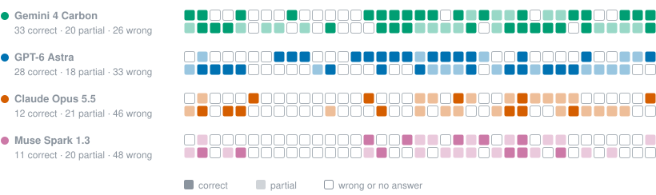
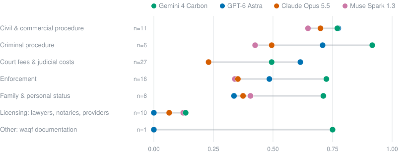

# Najiz Closed-Book: can frontier models recall basic Saudi law?

**With Saudi law named as the jurisdiction, the best of four frontier models fully answered 33 of 79 basic questions.**

We asked Gemini 4 Carbon, GPT-6 Astra, Claude Opus 5.5 and Muse Spark 1.3 79 short, practical questions about Saudi legal procedure, fees and licensing, from memory and without search. These are the kind of questions a court portal's help page answers. No model could reliably retrieve them, and none fully answered a single question on professional licensing.

**Mohamed Zaghoo** · November 2026 · Questions from the public [ArabLegalEval](https://github.com/Thiqah/ArabLegalEval) Najiz set · Graded blind by Claude Sonnet 5.5

[Results](#results) · [Findings](#what-we-found) · [Examples](#three-examples) · [How the models were run](#how-the-models-were-run) · [Run the demo](#run-the-demo) · [Method](#how-we-graded) · [Limitations](#limitations) · [Earlier two-model study](#earlier-two-model-study) · [Report (PDF)](docs/report.pdf)

| | Gemini 4 Carbon | GPT-6 Astra | Claude Opus 5.5 | Muse Spark 1.3 |
|---|---:|---:|---:|---:|
| Fully correct | **33 / 79** | 28 / 79 | 12 / 79 | 11 / 79 |
| Partial | 20 | 18 | 21 | 20 |
| Wrong or no answer | 26 | 33 | 46 | 48 |
| Mean rubric score (0–1) | **0.591** | 0.504 | 0.331 | 0.326 |
| Answered «لا أعرف» ("I don't know") | 15 | 26 | 6 | 30 |
| Wrong among questions attempted | 11 of 64 | 7 of 53 | 40 of 73 | 18 of 49 |

## Results



*One square per question, in the benchmark's order (Q1 to Q79). Correct means a rubric score of at least 0.85 with every core principle, deadline and amount present.*



*Mean rubric score by area of law. Where dots overlap, the table below gives the values. Areas were assigned by the author from each question's subject; they are not part of the benchmark.*

| Area of law | Questions | Gemini | Astra | Opus | Muse |
|---|---:|---:|---:|---:|---:|
| Civil & commercial procedure | 11 | **0.77** | **0.77** | 0.70 | 0.65 |
| Criminal procedure | 6 | **0.92** | 0.71 | 0.49 | 0.42 |
| Court fees & judicial costs | 27 | 0.49 | **0.61** | 0.23 | 0.23 |
| Enforcement | 16 | **0.72** | 0.48 | 0.35 | 0.34 |
| Family & personal status | 8 | **0.71** | 0.34 | 0.37 | 0.41 |
| Licensing: lawyers, notaries, providers | 10 | **0.13** | 0.00 | 0.06 | 0.12 |
| Other: waqf documentation | 1 | **0.75** | 0.00 | 0.00 | 0.00 |

## What we found

1. **Simple facts are the weak point.** These questions ask for a fee, a deadline or a list of conditions that a Saudi lawyer would look up in seconds. The best model was fully correct on 42% of them, and two of the four on about 15%.
2. **Licensing is a blind spot for every model.** None of the four fully answered any of the 10 licensing questions (lawyers, notaries, foreign law firms, enforcement providers); the best mean score was 0.13.
3. **The models know different parts of Saudi law.** Gemini leads on criminal procedure (0.92), enforcement (0.72) and family law (0.71). Astra leads on court fees: it got 8 of the 16 fee and rate amounts exactly right, against 6 for Gemini and 2 each for Opus and Muse.
4. **They fail in different ways.** Astra says «لا أعرف» when unsure and was wrong on only 7 of the 53 questions it attempted. Opus attempted 73 and was graded wrong on 40, including 8 wrong amounts or deadlines stated as fact. Gemini attempted 64 and was wrong on 11.
5. **Naming the jurisdiction matters.** The benchmark's questions never say "Saudi Arabia". In a first run without it, Gemini and Muse often said the country was unspecified or answered in general terms. Adding one line to their instructions raised Gemini's mean score from 0.468 to 0.591 and Muse's from 0.144 to 0.326.

### What the low scores suggest

These are not reasoning tasks. Each question has a short, settled answer in a Saudi statute, regulation or ministry rule. When frontier models miss them, the likeliest explanation is that this material is thin in their training data: Saudi implementing regulations, fee schedules and licensing rules are published mostly in Arabic, change often, and are rarely discussed online in the way that, for example, US federal procedure is.

The pattern supports that reading. All four models did best on procedure set out in the main statutes, which are widely reproduced, and worst on licensing rules and fee schedules. This study cannot separate missing training data from other causes, such as rules changing after a model's training or the effect of asking in Arabic.

> **For anyone deploying legal AI in Saudi Arabia:** closed-book answers to basic procedural questions are not yet reliable from any of these models, and the prompt must state the jurisdiction. A model needs current, cited sources, and a confident answer without one should be checked.

## Three examples

**Q5 · What are the court costs for a direct enforcement request?** Only Gemini knew.

| | Answer | Grade |
|---|---|---|
| Reference | <div dir="rtl">خمسمائة ريال.</div> | |
| Gemini 4 Carbon | <div dir="rtl">… تبلغ قيمة التكاليف القضائية لطلب التنفيذ المباشر (500) خمسمائة ريال سعودي …</div> | Correct |
| GPT-6 Astra | <div dir="rtl">لا أعرف</div> | Wrong |
| Claude Opus 5.5 | <div dir="rtl">لا أعرف المبلغ بدقة.</div> | Wrong |
| Muse Spark 1.3 | <div dir="rtl">لا أعرف</div> | Wrong |

**Q14 · What are the court costs for a financial enforcement request?** Only Astra knew.

| | Answer | Grade |
|---|---|---|
| Reference | <div dir="rtl">2% من قيمة المطالبة، على ألا تقل عن خمسمائة ريال ولا تزيد على عشرة آلاف ريال.</div> | |
| GPT-6 Astra | <div dir="rtl">اثنين في المائة من قيمة المطالبة، بحد أدنى خمسمائة ريال وحد أقصى عشرة آلاف ريال …</div> | Correct |
| Gemini 4 Carbon | <div dir="rtl">لا أعرف.</div> | Wrong |
| Claude Opus 5.5 | <div dir="rtl">لا أعرف المقدار بدقة؛ تخمين: نسبة من قيمة المطالبة يتحملها المنفذ ضده.</div> | Wrong |
| Muse Spark 1.3 | <div dir="rtl">لا أعرف</div> | Wrong |

**Q47 · What are the conditions for a lawyer's licence?** No model got it fully right.

| | Answer | Grade |
|---|---|---|
| Reference | <div dir="rtl">… أن تتوافر لديه خبرة في طبيعة العمل لمدة لا تقل عن سنتين …</div> | |
| Gemini 4 Carbon | Listed nationality, qualifications and good conduct, but left out the two-year experience requirement. | Partial |
| GPT-6 Astra | <div dir="rtl">لا أعرف</div> | Wrong |
| Claude Opus 5.5 | <div dir="rtl">… خبرة عملية (ثلاث سنوات أو أقل لحملة الدراسات العليا) …</div> | Wrong |
| Muse Spark 1.3 | <div dir="rtl">… ولديه الخبرة العملية المطلوبة أو التدريب المهني …</div> | Wrong |

Opus gave the experience requirement as three years instead of two; a wrong period cuts the score by 70%. Muse mentioned experience without a period.

## How the models were run

All four answered the same 79 questions in Arabic, closed-book, with the same core instructions: no browsing, tools or files; do not invent laws, amounts, article numbers or citations; say «لا أعرف» if unsure; at most 150 words. The way each model learned that the questions concern Saudi law differed:

| Model | How it ran | Saudi context |
|---|---|---|
| Gemini 4 Carbon | OpenRouter API, one call per question, default settings | One added instruction: «أجب وفق الأنظمة المعمول بها في المملكة العربية السعودية» |
| Muse Spark 1.3 | OpenRouter API, one call per question, default settings | The same added instruction |
| GPT-6 Astra | Codex, high reasoning effort, all 79 questions in one session | Implicit: the question file was named after Najiz, the Saudi Ministry of Justice portal |
| Claude Opus 5.5 | A Claude session already working on Saudi law, all 79 in one pass | Implicit: the session's prior work was on Saudi law and this benchmark |

Every answer set was saved with a SHA-256 fingerprint before grading. One Gemini answer (Q31) came back empty because the model spent its token budget reasoning; it was retried once with the same settings, and the empty attempt is kept in [`four_model_saudi/answers/`](four_model_saudi/answers/).

## Run the demo

Python 3.9+. No dependencies, no API key.

```bash
git clone https://github.com/mzaghoo/najiz-closed-book-eval.git
cd najiz-closed-book-eval
```

**1. Verify the four-model results (offline).** Checks that the graded answer sets are the ones in the repo, recomputes all 316 scores from the grader's element-by-element decisions, unblinds the per-question labels and prints the tables above.

```bash
python3 -m najiz_eval.verify_four
```

**2. Add the question and reference text.** The benchmark text is not redistributed here (see [Data and licence](#data-and-licence)). This downloads the exact source file from ArabLegalEval, checks its SHA-256 and rebuilds the full rubric, which must match the fingerprint used at grading time.

```bash
python3 -m najiz_eval.fetch
```

**3. Reproduce the run or add a model (uses paid API calls).** The OpenRouter workflow that produced the Gemini and Muse answers and the blind grading. Put an OpenRouter key in `~/.openrouter_api_key` first; the script never prints it.

```bash
python3 -m najiz_eval.openrouter --variant saudi answer google/gemini-4-carbon
```

```bash
python3 -m najiz_eval.openrouter --variant saudi grade
```

```bash
python3 -m najiz_eval.openrouter --variant saudi report
```

Add `--dry-run` to see the requests without sending them. To grade a model of your own without OpenRouter, see `python3 -m najiz_eval.package --help`.

**Tests**

```bash
python3 -m unittest discover tests
```

## How we graded

**Rubric.** Each reference answer was broken into required elements, 270 in total, taken from the reference text only:

| Element | Weight |
|---|---:|
| Core principle (P) | 3 |
| Deadline, period or term (T) | 2 |
| Amount, rate or payment (M) | 2 |
| Condition, exception or detail (X) | 1 |
| One item in an enumerated list (L) | 1 |

- An answer that contradicts the reference scores 0.
- A wrong amount or timeline multiplies the score by 0.3.
- A wrong citation costs 2 points.
- **Correct** means a score of at least 0.85 with every core principle, deadline and amount present. **Partial** means at least 0.40.

The scoring rule is in [`najiz_eval/common.py`](najiz_eval/common.py).

**Grading.** Claude Sonnet 5.5 graded all four answer sets one question at a time, through OpenRouter at temperature 0. For each question it saw the reference answer, the rubric elements and the four answers labelled A–D in a fresh random order; the key ([`four_model_saudi/grading/key.json`](four_model_saudi/grading/key.json)) never reached it. All 316 scores were recomputed from its decisions with no differences.

## Limitations

- **Saudi context was not delivered identically.** Gemini and Muse received one explicit instruction; Astra and Opus had implicit context of different strength (see [How the models were run](#how-the-models-were-run)). The answering setups also differed: API calls at default settings for Gemini and Muse, Codex at high reasoning for Astra, an ongoing session for Opus.
- **One grader.** Sonnet 5.5 is from the same family as Opus 5.5. That bias would favour Opus, which still ranked third. No lawyer has reviewed the grader's close calls.
- **Grading noise.** Astra's and Opus's answers were graded twice, in two separate runs, without changing. Their mean scores moved by up to 0.03, and their labels agreed on 78 and 70 of 79 questions. Differences between models smaller than that are not meaningful.
- **One sample per model.** Answers vary between runs, so a single run cannot separate ability from chance.
- **Small and Saudi-only.** 79 questions, mostly procedure and fees, from one portal. The results do not cover other Arab jurisdictions or legal drafting.
- **Reference answers are the standard.** A few reference answers do not directly answer their question (noted in the rubric), and some may be out of date.
- **Possible contamination.** The benchmark has been public since 2024 and may be in any model's training data.
- **Closed-book only.** With the benchmark's context passages, all models would likely score much higher. This tests what the models know, not how well they read.
- **Self-reported model settings.** Model names are the requested settings; OpenRouter reported serving `google/gemini-4-carbon` and `meta/muse-spark-1.3` for every request, but serving infrastructure is not independently verified.

## Earlier two-model study

The first version of this study compared GPT-6 Astra and Claude Opus 5.5 only, graded blind by a Claude Sonnet 5.5 session that saw each model's whole answer set at once. Astra fully answered 30 of 79 (mean 0.536) and Opus 12 of 79 (mean 0.398). Those answers are the same ones used above; the four-model grading re-scored them alongside Gemini and Muse. The files are in [`answers/`](answers/) and [`grading/`](grading/), and `python3 -m najiz_eval.verify` reproduces them. Its report is kept as [`docs/report_two_model.pdf`](docs/report_two_model.pdf).

## Next

Run the same questions with the benchmark's context passages, take several samples per model with identical instructions and settings for all four, add a second grader from a different model family, and have a Saudi lawyer review the disputed grades.

## Repository

| Path | Contents |
|---|---|
| `four_model_saudi/` | The four-model run: Gemini and Muse answers (with raw API records), the grader's decisions, the blinding key, scores and a summary table |
| `answers/` | GPT-6 Astra's and Claude Opus 5.5's 79 closed-book answers, as saved before any grading |
| `grading/` | The earlier two-model blind grading |
| `rubric/` | The 79-question rubric: element types, weights, rules and 270 elements, without the benchmark text |
| `najiz_eval/` | Verify, explore, fetch, package and OpenRouter tools (standard library only) |
| `docs/` | The four-model report as a [PDF](docs/report.pdf) and a web page (`docs/index.html`), the earlier two-model report, and the charts |
| `tests/` | Tests that reproduce the published numbers and the scoring rules |

| File | SHA-256 |
|---|---|
| `answers/gpt-6-astra.json` | `756d706e963a6298d8d9628e867a4cac9db39b4d8263625547471b0a3e330aac` |
| `answers/claude-opus-5.5.json` | `dea83df461c0a612e1f5b8097d9c5b5c828e4bda725de83c5740eaee4271a7b8` |
| `four_model_saudi/answers/gemini-4-carbon.json` | `9ae3c835005e7f853bc941dee78d992de6e0b65742315f28dacfafda554c6a17` |
| `four_model_saudi/answers/muse-spark-1.3.json` | `9340465792dceacd4165bd48abb34efad94b27ef8d6776ba9592fcaa6b11465a` |
| Full rubric, rebuilt by `fetch` | `68e1aaf55bb7887409db30c1b7229e6904efd437ac99c10f327892b8cdc3d180` |
| Source benchmark file | `72bdc6bf5d75ba9d00fd406c9545ea822ccb43169410c3e111a7f16b5072e6b6` |

## Data and licence

The questions and reference answers belong to [ArabLegalEval](https://github.com/Thiqah/ArabLegalEval) (Thiqah), which publishes no licence. This repository therefore does not redistribute them: `najiz_eval.fetch` downloads them from the original source. The rubric's element texts are short extracts from the reference answers, used to grade; the examples above quote reference answers briefly for illustration.

The model answers, grades, rubric structure and code are by the author. No open-source licence has been selected yet; public visibility alone does not grant reuse rights. Development used AI assistance for code, analysis and writing. No endorsement by any model provider or by the benchmark's authors is implied.
